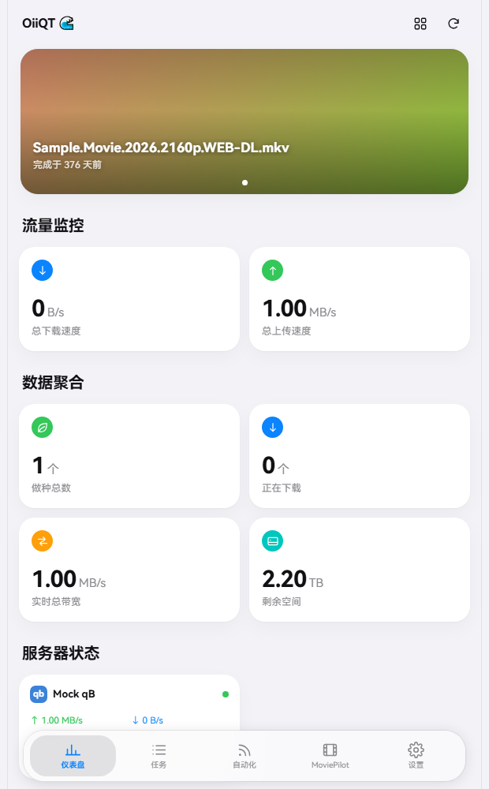
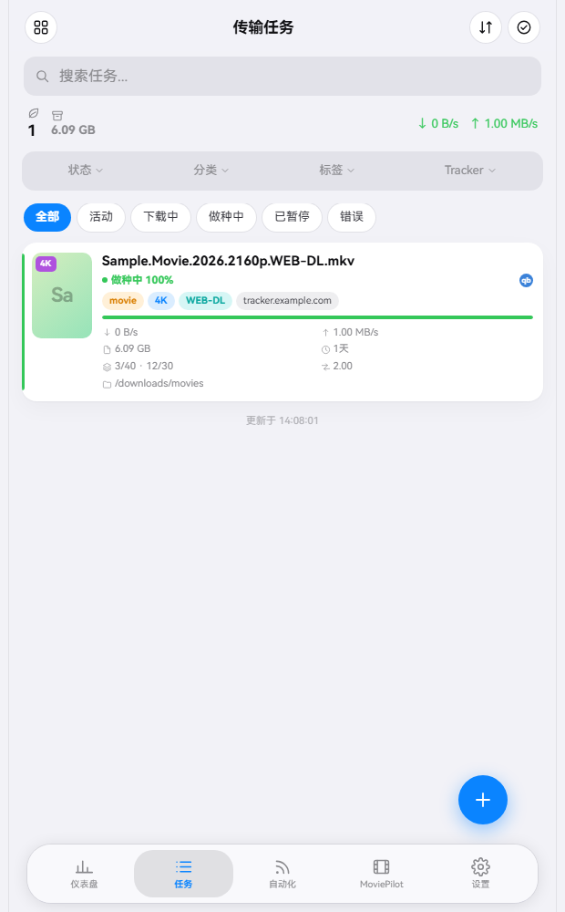

# OiiQT for Android 🌊

把 [gangz1o/OiiQT](https://github.com/gangz1o/OiiQT)（SwiftUI 写的 iOS/iPadOS 客户端）复刻成能在**安卓**上使用的版本：管理你的 **qBittorrent / Transmission / MoviePilot** 服务器。

原项目是 Swift + SwiftUI，代码无法在安卓运行，所以这是**用原生 Web 技术（HTML / CSS / ES Modules，零框架、零构建）按原项目的 API 契约与交互设计重写的实现**，视觉上对齐 iOS 的分组卡片、胶囊标签栏与任务行。

> **许可与归因**：原项目采用 **GNU GPL v3**，本仓库同样附带 [LICENSE](LICENSE) 全文。本项目未复制其 Swift 源码或品牌素材，但参考了它的接口定义与界面布局。若你分发衍生作品，请继续遵守 GPLv3（保留许可、提供对应源码）。
>
> **无会员、无内购、不限制服务器数量** —— 与原项目一致。本项目不提供、也不托管任何下载服务器。

---

## 为什么需要这个文件包里的 `server.js`？

qBittorrent WebUI 和 Transmission RPC **默认不返回 CORS 响应头**，浏览器里的网页无法直接调用它们；qB 还依赖 `SID` Cookie + `Referer` 做鉴权。所以有三种请求方式：

| 方式 | 适用场景 | 说明 |
|---|---|---|
| **反向代理** | PWA（推荐） | 随附的 `server.js` 在服务端转发请求，自动维护每台服务器的 SID Cookie，浏览器无跨域问题 |
| **原生 HTTP** | 安装 APK 后 | Capacitor 的 `CapacitorHttp` 接管 `fetch`，绕过浏览器 CORS 与 Referer 限制 |
| **直连** | 你已自行配置好 CORS 的反向代理 | 直接请求目标地址 |

「自动」模式会判断：在 APK 内 → 原生；网页检测到同源 `/proxy` → 反向代理；否则 → 直连。也可以在 **设置 → 请求方式** 手动指定，或填写远程代理地址。

---

## 方式 A：PWA（最快，5 分钟可用）

**1. 在 NAS / 家里常开的电脑上运行服务**（需要 Node.js 18+，零第三方依赖）：

```bash
cd OiiQT-Android
node server.js
# 默认监听 0.0.0.0:8787
# 自定义：PORT=9000 HOST=127.0.0.1 node server.js
```

**2. 手机与这台机器在同一局域网**，用 Chrome / Edge 打开：

```
http://<电脑或NAS的局域网IP>:8787
```

**3. 浏览器菜单 → 「添加到主屏幕」/「安装应用」**。之后它会以全屏独立窗口启动，和原生 App 一样，有图标、启动画面、离线应用壳。

> **关于 HTTPS**：局域网 `http://` 可以正常添加主屏幕快捷方式并使用全部功能，但 Chrome 只在 **HTTPS**（或 `localhost`）下启用 Service Worker / 完整 PWA 安装。需要完整体验时，给 `server.js` 配证书即可：
>
> ```bash
> SSL_KEY=./key.pem SSL_CERT=./cert.pem node server.js
> ```
>
> 也可以在前面挂 Caddy / Nginx 做 HTTPS 反代（推荐，用 mkcert 或 Let's Encrypt 签证书，手机信任后即可）。注意：若页面是 https，远程代理地址也必须同为 https，否则浏览器会拦截混合内容。

**4. 首次使用**：设置 → 服务器设置 → 添加服务器，填地址/端口/账号密码，点「测试连接」后保存。

> 建议在路由器上给这台机器固定 IP。若要外网访问，请套 HTTPS 反向代理并加访问控制，**不要把 `server.js` 直接暴露到公网**（它可转发任意 URL）。

---

## 方式 B：编译真正的 APK（无需本地 Android SDK）

仓库自带 GitHub Actions 工作流，会在云端装好 JDK 21 + Android SDK 35 并产出 debug APK。

**方式 B1：一键推送 + 云编译（推荐）**

`push-to-github.js` 只依赖 Node 18+，通过 `api.github.com` 的 REST 接口上传文件，因此即使网络只放行 API、无法 `git push` 也能用。它会自动建仓库 → 推送全部文件 → 触发编译 → 轮询结果 → 把 APK 下载到 `builds/OiiQT.apk`。

1. 在 GitHub 生成一个 **classic Personal Access Token**，勾选 `repo` 和 `workflow`（[生成页面](https://github.com/settings/tokens/new)）。Token 只从环境变量读取，脚本不会写入磁盘或打印；用完建议立即撤销。
2. 执行：

```bash
# Bash
GITHUB_TOKEN=ghp_xxxx node push-to-github.js                       # 公开仓库 OiiQT-Android
GITHUB_TOKEN=ghp_xxxx node push-to-github.js 你的用户名/仓库名 --private
GITHUB_TOKEN=ghp_xxxx node push-to-github.js --dry-run             # 只看文件清单，不联网

# PowerShell
$env:GITHUB_TOKEN="ghp_xxxx"; node push-to-github.js 你的用户名/仓库名 --private
```

追加 `--pages` 会同时部署在线版；`--no-build` 表示只推送、不触发构建。构建日志与产物始终可以在仓库的 Actions 页面找到。

> **私有仓库 + 在线版**：GitHub Free 不允许从私有仓库发布 Pages。所以带 `--private --pages` 时，脚本会自动再建一个**公开**仓库 `<仓库名>-web`，里面只放前端静态文件（HTML/CSS/JS/图标，不含任何账号或服务端代码），源码仓库仍然私有，在线地址为 `https://<用户名>.github.io/<仓库名>-web/`。若源码仓库是公开的，则直接在同一个仓库用 `deploy-pages.yml` 部署。

**GitHub Token 权限**：需要 classic PAT 勾选 `repo` + `workflow`（创建仓库、推送文件、触发工作流、读取构建产物）。Token 只从环境变量读取，脚本不会写入磁盘或打印；用完请到 Token 设置页撤销。

> **在线版的能力边界**：GitHub Pages 只能托管静态文件，跑不了 `server.js` 反向代理。手机浏览器直接连 qBittorrent / Transmission 会被 CORS 拦住，因此在线版需要在 **设置 → 反向代理地址** 填入你自己 NAS / 常开电脑上 `server.js` 的地址（形如 `http://192.168.1.10:8787/proxy`，建议配 HTTPS）。想不依赖任何常开设备，请用上面的 APK。在线版仍需 HTTPS 才能提供完整的 PWA 安装体验——GitHub Pages 自带 HTTPS，正好满足。

**方式 B2：手动推送**

1. `git init && git add . && git commit -m "OiiQT for Android"`，推到你自己的仓库。
2. 打开 **Actions → Build Android APK → Run workflow**（或推送一个 `v*` 标签自动触发，并附带到 Release）。
3. 运行结束后下载 Artifact `OiiQT-debug-apk`，解压得到 `OiiQT.apk`。
4. 传到安卓手机安装（需允许「安装未知来源应用」）。

APK 内默认走原生 HTTP，不依赖电脑或 NAS 上跑服务；登录 SID Cookie 由客户端显式维护。如果某些 qB 版本在原生请求下出现反复登录，可在 **设置 → 反向代理地址** 填入 `http://<你的电脑IP>:8787/proxy`，让 APK 也走代理。

**本地自行编译**（机器上有 JDK 17+ 和 Android SDK 时）：

```bash
npm install
npm run cap:add     # 生成 android/ 目录
npm run apk         # 输出 android/app/build/outputs/apk/debug/app-debug.apk
```

---

## 下载器端准备

**qBittorrent**：工具 → 选项 → Web UI，启用 Web 用户界面，记下端口（默认 `8080`）与账号密码。`API 路径` 填 `/api/v2`。若经过反向代理，请填实际路径。

**Transmission**：启用 RPC（默认端口 `9091`，路径 `/transmission/rpc`），设置用户名密码。

**MoviePilot**（可选）：设置 → 扩展功能里添加实例地址与 API Token。客户端会自动尝试 `Bearer`、`X-API-KEY`、`?apikey=`、`?token=` 四种鉴权方式。

---

## 界面预览

| 仪表盘 | 下载任务 |
|---|---|
|  |  |

浅色 / 深色主题、圆角卡片、胶囊标签栏与任务行的信息密度都对齐原项目。截图来自本地模拟服务器，真实数据会替换占位海报。

## 功能对照

| 模块 | 原版 OiiQT | 本复刻 |
|---|---|---|
| 多服务器（qB + Transmission）、聚合视图、切换 | ✅ | ✅ |
| 任务列表：搜索、状态/分类/标签/Tracker 筛选、6 种排序 | ✅ | ✅ |
| 添加任务（磁力/HTTP 链接、多 .torrent 文件、保存路径、分类、标签、高级选项） | ✅ | ✅ |
| 任务操作：暂停/恢复/强制开始/校验/重新宣告/删除/重命名/改路径/限速/文件列表/Tracker/分类标签 | ✅ | ✅ |
| 批量操作、多选 | ✅ | ✅ |
| 仪表盘 7 个模块（海报墙、流量监控、近期传输、数据聚合、服务器状态、存储审计、近期完成），可开关 | ✅ | ✅ |
| 全局限速、预设路径、Tracker 别名、隐藏节点名称 | ✅ | 部分（限速 ✅；qB 完整偏好设置编辑 ❌） |
| RSS 订阅源 + 下载规则（关键词/排除/正则/体积/目标服务器） | ✅ | **简化版**：前台抓取、匹配预览、一键提交；无常驻后台调度 |
| MoviePilot 发现 / 搜索 / 详情 / 资源 / 添加下载 | ✅ | **基础版**：9 个发现源、媒体搜索、资源列表、提交下载 |
| TMDB 海报匹配 | ✅ | ✅（需在设置里填自己的 TMDB API Key） |
| 豆瓣海报、手动海报匹配、CrossSeed、Peers 管理 | ✅ | ❌ |
| iCloud 配置同步 | ✅ | ❌ → 改为 **JSON 配置导入 / 导出** |
| 深浅色外观 | ✅ | ✅（跟随系统 / 浅色 / 深色） |
| 中英文 | ✅ | 简体中文界面 |

状态归一化沿用原项目的 7 种枚举（下载中 / 排队中 / 做种中 / 已暂停 / 校验中 / 错误 / 已完成），qB 的 `eta=8640000` 视为无穷，Transmission 的 409 Session-Id 与 qB 的 403 自动重登都已实现。

---

## 安全说明

- 服务器地址、账号、密码、API Token **只保存在本机浏览器 / APK 的本地存储**，不会发送到任何第三方；关闭「在本机保存密码」后，密码仅在当前会话有效。
- 导出的 JSON 配置**包含明文凭据**，请妥善保管，分享前先删除。
- RSS 链接常含 `passkey`，请勿截图外泄。
- `server.js` 的 `/proxy` 允许转发到任意 http(s) 地址，请只在可信局域网使用，或在前置反向代理上加认证。
- 自签 HTTPS 证书可在服务器编辑或设置里开启「允许自签证书」（代理与原生模式生效）；浏览器直连模式无法绕过证书校验。

---

## 目录结构

```
index.html                 应用外壳
css/style.css              iOS 风格设计系统（浅色/深色）
js/app.js                  路由、刷新调度、全局事件委托
js/core.js                 共享内核（避免循环依赖）
js/store.js                本地持久化与运行时状态
js/transport.js            三种请求方式 + 代理协议
js/clients/                qBittorrent / Transmission / MoviePilot 客户端
js/views/                  仪表盘、任务、自动化、MoviePilot、设置
js/posters.js              可选的 TMDB 海报匹配
js/util.js                 图标、格式化、Toast、底部弹层
server.js                  零依赖静态托管 + CORS 反向代理
capacitor.config.json      APK 打包配置（启用 CapacitorHttp）
build.js                   把静态资源复制到 dist/
push-to-github.js          一键建仓 / 推送 / 触发云编译 / 回传 APK
.github/workflows/         云端编译 APK
manifest.webmanifest / sw.js / icons/    PWA 资源
docs/                      界面预览图
```

---

## 常见问题

**Q：一直提示「连接失败 / 跨域 (CORS)」？**
A：说明当前是「直连」模式。启动 `server.js` 并从它提供的地址打开页面（自动切到反向代理），或在设置里手动选「反向代理」并填代理地址；安装 APK 则默认没有这个问题。

**Q：qBittorrent 每隔一会儿就要重新登录？**
A：代理模式会按服务器 ID 维护 SID Cookie；若修改过密码，保存服务器时会自动清空 Cookie 罐。仍有问题时把请求方式切到「反向代理」并重启 `server.js`。

**Q：Transmission 报 409？**
A：客户端已实现 `X-Transmission-Session-Id` 自动重发。若持续失败，检查 RPC 路径是否为 `/transmission/rpc`。

**Q：页面用 https 打开，却连不上 http 的 NAS 代理？**
A：浏览器会拦截混合内容。请统一用 http 访问，或给代理也配 HTTPS。

**Q：APK 里图标/海报加载不出来？**
A：海报来自 TMDB / MoviePilot 的外网图片，需要手机能访问；未配置 TMDB Key 时显示渐变占位图，功能不受影响。

---

## 致谢

- 原项目：[gangz1o/OiiQT](https://github.com/gangz1o/OiiQT)（GPL-3.0）—— 界面设计、API 契约与功能范围的参考来源。
- qBittorrent WebUI API、Transmission RPC、MoviePilot API、TMDB API 各自归其原作者所有。
